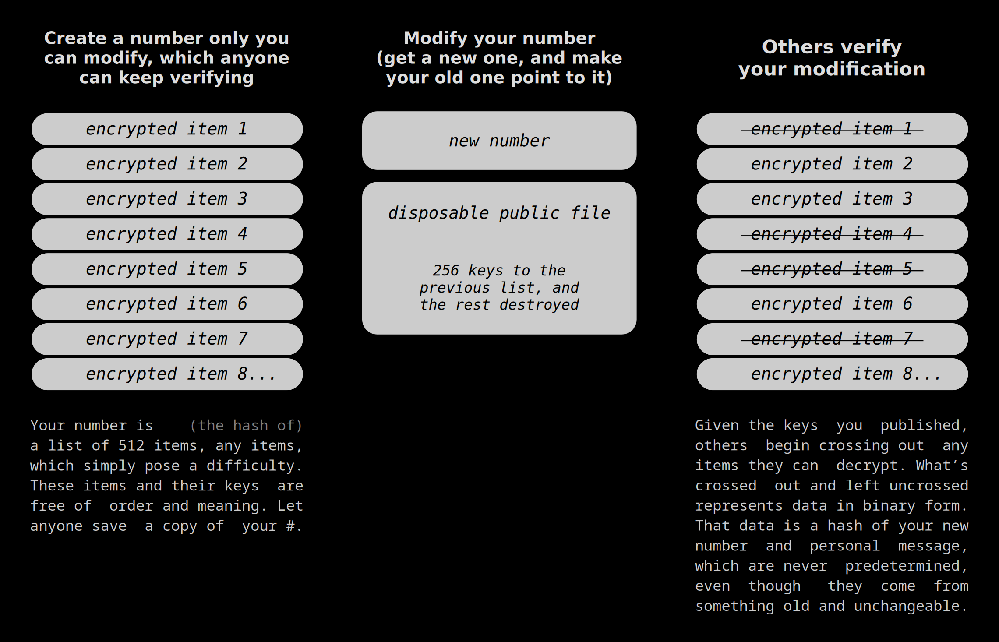

### Run it

```apt install g++ geany```. Open the .cpp in Geany. Hit F9 once. F5 to run.

<br>

### Terminal

```text
(1) Create   Your number which others save.
(2) Modify   Creates a disposable public file with which others verify.
(3) Verify   Their new public file modifies their number file which you saved.

Option: |
```

<br>

### How it works

<p align="center">
  
</p>

<br>

### Your number (SHA-512 hash)

```text
1cb0e5a50aa748359e1fc84d640320a3daed7c83c535045ca3478c8a30ffb929cbc8c9816683b8e3e02d81d23d2e03ac6ed3a108a23d3fbdf1341c79ddf46e66
```

<br>

### Disposable public file

```text
512 ciphertext:       
256 keys, 256 absent: T/|rL8uh`J{b>vW*!3(Bl'$>06'yr*1^ak%\u~1TGUC\V5"T6~lp["%Cs;Kqn,Q,.cQyh8Kw#54}Gv.'d"&KzJ:EWB#s[<jhb/uDEVVh{HwA^"PS(4:Ms/|Ws>w+^y[9:GNW50w+T]]{T{hH$JSXx~D[p[M&ei;pPLEGX0nw>DjbV:hb<{0nqaL[H&p`='q[O}*V>cJuLoZ7{m8+4Vz!3*E*G:hBVj/To|,TF%p."=^'1mI4_V-DC;doAV-#RXu&Ig-rkQ\e^Tz{_e[N5bo"'lTjD&7&_{:^~Oejo!xL9%U#Nlou/%Z`.~^*6F2Yba~5e:PSEzibMS;*Z]U0lb#A@W]mNLS3/6:0xV9Ars.0HOVYH!:O`_j`-T`#yX0?]f@r                                                                                                                                1`Wn`7his#HQd+i@9m\Em2Nsd:dz[z^,\k%!s+vQnY!lxtSLZ^Jh|)$tZXN4%lQ!o4Bbfro>"32@k<@#h_\~PQMa0{yWMM[PJ'df?lA~Bq$Vr1mRv!Tv=@yF\\L+RYi3                                                                                                                                Yvf*.vqP@*+qh\erg!~=mIo*M`)E+i^Bqci@wuEc;simNknMlUDo%~+W,3vQ\^td$EM#4[&%zd9R*/W0kOp&e*(1>4]"*F`Vhy!X0@BkQmt0H&(6:oM&A#dET=nzt0H@TnB3)T.M9'm/diY@bTv{2Ru\UCyRtq7gp-JP'1*4l&$[$G3['(<s6M(5]{B.Ap0bk;?&OE3_:0tNcgI~nH5VO9Qz|.GNDwUFt_pTt:kQ8#|W,&\al}{1{A!(z5u)"(O=)9kViggZPqqc$~GE]gPDFER4r|;d_MbqIfi-op.rpt]d<!UavI4zwg1TO{3`lW>y/`>5z9bgVM;]wJ"*n7}.L_~_%5|W7&69\s~q_7-'9I:5IIY>rpmvM&*oei}$MY4`Pj-wpIOy.%n?uM.:+%G=W(d|"`)ZTlb]#\Ne0Ll_o*TIEufyzJu#`VT}P=I*[x)j};J/5G=>6[5dmUGwOYc=.|@Y,aTpCA}!Vy?:2z70fA|!ydKdD*.YukhkKK,_P]gV                                                                                                                                                                                                                                                                                                                                                                                                                                                                                                                                                                                                                                                                v*D]lm^=G}l/6Md^nD|}=+"&HTQH{5(N%;nfZ~R[)*T^4oI_#T!Fb/Rqk/~)L<ka@|ZA{YtAm;dWAcR_Vo3+rbM<#&tnf_+Mob=/E+HAYEnuwr7%-zDQnyEOGze>GLC}                                                                                                                                S2RLaQmm2f'D['KmJ^':}ifw:JM(_a|AuZe|60*WjBzeW23#%d]5;!Ax&XI\>]WK?YE=Fvq&m'_SxNdQPpOtt82Cq]CC}r`P]bUb~C'yIHd12U^<M?s2{ifcwxqYr9uSvw^DR#6Y![]Yjas/+FY}\x$i?H@Y9QYjT,Pvsyos6$13J5D\|&r/K;<I8uk,+Q|%2o|%5h#t]LD/R~FCD,ZYi*r`sP`e;m\kGebC*&;EM;\pP6jf;BUtP5G[Yc9Z1L<E)y(BEI4o[[Ohfqy]}K`P{N{EgjhG>nA_[<y"1\3o~HdnOVEQS8^fQq;cEB30icp]Hf~rin1uxFHfW_<edQZV#$8O@!#?k`HleKbY#7b'L8OgR|3n^_99Qi,^+w-m\)51HO5k/~<^DjZ&1=<\}%n;KY:B@N#3BrZk<Z*8@+>hd<[?B~#eg/,>tS:U>%:JNM]Cn%I\yN%+bgD!7GX1O`<PXzstkG&BRC5-:wM!-@}{LILO"W_1UJYCM[nHAs"7seK"<webNv|`3N^HCfCq]t@DZf1wqC*DaD>C:DdIADF*Hqmu,M'N`vhBSSa|g$Y4M-M\eq5-Y<^&k9~AJ?ylMu(P>#tsd,Flv2oDG#~f~QTyJtp:TXOK@a4G^ui)mJkG)M1@                                                                                                                                W(~g}@o'$nwGp"}Lt$DVy\R]~G$Ea4`W'#zPE.dJs'v5BSEx(w26A5+'F*KdS+VfMnePUex5'Z:_nUy<m*c/gY8zstmw8u=]G3bN[QqR05_{:qR`3<E^:e3A5wh!X>UL[6jxM^FQ@*Uz_)O*}]*I93<cV#Klg`Td<,OP^EwgcFT$|y2N$(W~`d(YgW#9yh1Rac'5z-xO"c!\!68`%~yi!94j%qac.+4cz[7>B!Kk$0fc~3Vt$>pda)l'IvN{fq}g                                                                                                                                pU[}x%Gx'\9"R&:cy/Hpv;[MSG0P_5d_Z=k#'44jnC*Y?T{G,z3WKlc|J8]tH<['k7)X_OZh1EjV6!n:;UX1OH`)lN><\F{pDW|lQIl#f;vO*|7J-Y6{z;K.]%O4;sZ~                                                                                                                                                                                                                                                                klYFT9SIJ&S|e:|k1Iwh{7x'J55q)N;[X^,=FgnWt3_83C=T'\&[R%9\4"jd"@f@a-~y'E7ue,jjmk#Qw*bp8Q({`R]*rgf8KZ=8q!b?p/;V\ffD~>|2VPD\Zx(AS?O1                                                                                                                                                                                                                                                                                                                                                                                                {@Wbu*7kgQ3ggiC}tI@XIU[4P+|WQ)[rc-4]6L@G9@'2D_pf'7H%T_.0u9kG^V*=XyX|<'jw=84:)<dtFrJ2at_R4B@aY;UIN2U|EovS1De$[^m+!'mh~7/tL9'rqa%p                                                                                                                                                                                                                                                                                                                                                                                                Oxq|\R<#Ke-jMuf'Ja)/WH/#nPD}V5<?);]B0lr_F]y_GS"FJ:o;C\h{h-@$$"y>.kZ'N_*UWu0"hLNh5PB?lYOgP*%B85#(6jsagkrol<'oA/oeTcjfk7Zj4VBjgyeu                                                                                                                                                                                                                                                                                                                                                                                                                                                                                                                                                                                                                                                                                                                                                                                                q["WhANR3]ide;*ED^IAbyRyg<0Hy"a<@Y/!Vh/Sx-8C4bYU+B4jrbhfO5r,INVA@.2%d#^V`*kI[Ht$9lNVK<?g|pnb"3cw@(v|].5I6zljNG3~2B=K"zvUsAb@#cm,                                                                                                                                z_W]~kQbc02%-p-}$0sIU459L_%+{)AI{{Q:L<DQ>J%vxRZu:|,^|Gg.2%RQZvWrFMA[^=8DcIn&jXc>"zcGf%BZ&J95n]o-MC\Jt\'@B<<:b8'W<Q@WudCBU61.'F*zi%t]r@uZ`'1#/f~{4P3HQsi&Ylu"na^^e3]uXM4\(9WD5)[-H[}Dh3@MD*=s\"N#lRN@Ck>t@/aK@aa~]uU3su4o;UGU-6&i[7l6#=![Vp<M.K+/z-xRa`[S[~:j[:M%                                                                                                                                iAS(N*K~MB>bw2JoQE%<Ur6yQRrwwE#_x{@Az?d/BDTE=d7YD"3ObcH5|D=G8Y/LgA'/"fqts'}J2{g[65-SB?l-f+T%/qXoi<h8'sIE;h;$L?m`O]4sJ(<$8U\eeu",                                                                                                                                ,8E`Q'>c8`Om)_vII+n:R%nNFZepFD4:6'd_|(</D.&,,2c"E>}#%T&pw/Xlnc.~r%edk'(Hy4mvd}!':Alq<1G>Z=qU5$;=8x5PKhFh-]:j\PD^_x7oVCf7Y?u.p#?>                                                                                                                                                                                                                                                                {N!Yz:1+Sj.xP*1-)+Z"X%r(|OFjM)nlT!S%c:tRs38q9w-Q.m?21VTJ5NLNH1'xnq2yBl7%!mUXY]7pn7ws$+ok0`#lZu?,:S)9"+sj'^x97+[O*&AuY:O&)^~J0D&|c?i1[AjygZ^oA3Q(Szb)_qKoj^uhjQ@n._N6|6)va.K[\X5u-R?yCn:GgWdXtZ~{C-Mju)B9LE"-fI'w}"53J=>O`%Dk:e-]-XlssDnC]$Nkh2;?m,Iy'!S5*%]>l2GgXkU8w'~DE.}Ri\.q.sgBR5r_}UL@z\SsZZSP3QE/@X%8;O<ud!`,tDtsT/OZID/A;S~|LT:Kt'~{o-VvT0[u;zuqB2fOV-6&}@fY>fug<}Z87+`JNYsIg{)ZizKe)-(c                                                                                                                                inb;vS7y[eE;f{t}fPyPy)Ywww3jw+|{L[OT#AH?HJD9?P)[tBl38'A|Hi"K]tB-0HIH|O:aF#;zC*x0Xiu6k/E1GAPK\\o`#D?.)s<>usV)}8X^CmAGzL)h}z.KsdWj                                                                                                                                                                                                                                                                                                                                                                                                                                                                                                                                s(YIqstFt/A6](PsR]:eo?>[q)M]UkG%Lx@j=SkIe'8O*=Q0#,BdbQbsh9)|*,XA\_|H:9oQ{_k_dBq>$]/Q9!{IJLzs~W',}SmJ0*l\uD.j{/qgWIP2zEA+7t<|/?A:OIO>]A&~,ZR?ADlrXo,>!s)]<kY*BXN;$prBLJvWy{lq6PJ8blOS#$:.#:z%g+Si$LiJ!-*.L4I]LOYr?{v}Xlau/,&iDE5$R2(ZZ*u''\IJlhD1s3B}oFs]G//i7{?D                                                                                                                                                                                                                                                                UI[jzfR0/:[[A6^,KSJg}0ifAxbap|qvgvQR%c<c.!#.fd=;G#<;ih{k&3R`'"rH&k<m4{X>!pN37lzGB^j!kp7]~x(1})nG8?>/N&afg!QBpA]H+#w]5?TH$u[0!akI4:JXyUc>^o&|@hX)v7!%WcH{s>TD04C}bM@35xf+L`BzIk.Ag_i83{05}+4)^_WQr=c:zDFSl0Ru|w4?nvaK&8I'XE|%JN/w0oAigekARvZ"yR)y51>IUep4=VubWgy='x-0my4j0-9h0Rvw+KakY_bbI!M3K~685|?w~lR-g%wnY4/?|H9KGbJ*-q~Cp~qso$vLz#`g"j4u9QjxW"C;{R+`7eg2fk6ecR"6YMd:8d95WNs+\MWj:eY7Y2oPn^^A(MN%sf\;+<XkXR<Vur;RD2`#/(FM2N`&=Jm,>{y(z=7]7,vi{,nm:5x'7vQs|\q6dbSs^<y'QovY8y#0sW#)XhF'V(h)7U[v$:~UCh0U|k{5xJze2AJ9_+J6C&^')HK'Ru(lN,J-u`U>jJCoeN\7Q|Av&"f_\<}*Ayw09`.\,PmULo=hFD5V,g7/(=v/@c0E.j-4+h$~{+c^<V>hJ.{L=q>I\$20)l^`Z>hT!r*;<"8hsLirvDr-h8y9ZBZ!)Ad)                                                                                                                                a\9xVk]WB#s#~#hAmatCe:<bg;-DRVd,eky@HGT7"&mX6Z42pAbaI8@@(D?ySUX1m~UK3d&$4qok/-JUJM7Xn(Ub!csj-z_4,SgQWr/V(az|&;\s~}9;d,mW{Mihy(2r                                                                                                                                dk[JAbyGXR/Xq^RS79p=TGGWor|.}1Q~~X$zIISu(cyl^Uw%W7a-W;'qA:*[YsQfe!E{3XY;O_syrwTaBW>4d}Z,?h$yc9)H\$_1kvEN.+[G$*ooilNcTywZ]~<=2ip<                                                                                                                                                                                                                                                                z90tbG_v{AhwxB~@GNhe<0bQ7t,7HA>CJk&;m.X9$x"_F!SEv@s{/zTB8^;$0wIC@M/.r\SIx_0l(M'E0#"@YEbfzYr|="wYpz/Gm3:\GUm,':P!"xS)Gcb&gT\/t\6Z                                                                                                                                                                                                                                                                4F]'s;tX#EHEEq*A"8qI\[UJM`*[?h.)IVe|Uq/[/U<(Vk'43$#4z}f+/OMv+gLk"SseL:9U{`)YR_8%wwd`BaG~u~.9Bt.krFVFHW:$+JPMBTtRVtmkCD@?i@3gF>;450TBegM:\pNo\)v(J@lm&C83Cpl^v@sd1V6O2M[.)9|Qj9a3OAFiAm3n=uoP^)c,R03%%e1P6RG&T{mLGF!0#}*Kugl8G6S'T~$Z\*X}L$T&Q]s-h~xO+r]#448VQ1^;BW)S|Q@?g?)p#NyO/bxP;3Cw82q[WnzVA7:G%u9|""4Db>MEWU&uKTl~q:fzpTs|!.CqS\&hJTL8Z4'e+'i[t9b07rD5S"_H$;5sQBadT222u=4Bf646@['>X/S-]V?R                                                                                                                                                                                                                                                                Bx$J,ha63kO?dk2*AHKyI|0lWh!}rLx&a"ce(3o^`R;X"n>Z.Yt31Ao<FUrX85UsC>%y+|jW>Kf~BN#</u3!Py>JV)h1F~mg_8.OPmz":G/hro+?n%DG`.A1kM#>due.                                                                                                                                Ujpa/Cf4t[5Kq$Nj_A^`@x,IpI?DP$Mq`)=D!s[($h@*hIkiorZvA[nr}K/M<T_Z?(tqr9[M,4JoqBEj"~%\\T6pvA$C7[%GDX/:eNGX_+oeYk0RaDUU\N8"[}6]\zgj                                                                                                                                                                                                                                                                                                                                                                                                onT#Bl[^6hWeMoH)jA?5]MOH>&k^D4W/P1C^\=y=bw:\/1`u+!I69/2Fr[_2~!33S*dBI;"?i%Jg#V|RfaaU~+"}./My.,DsD2Fa&#:Wej)2Rsu@}=vgS}{d3T^4akPN_yG>fr^sr,:<{&s@5)AJ)FR,3BGZ;h$M>KUa"Y,03{1V|[[6%LiIV'}u7AT^eXl8_&9SBe?|_[Fc$j[ghq<zw\Ss`:;!iHgY!xoZ~hxkOl>(y.?;#AY4d\r`$KDZ=O{X                                                                                                                                U0Q!9lOD!F/z5Pn%c5<5Z]Aw?"-YPAMz}F]rP4RQ5YNu8~XediE1=s-)As;|!:RiETtqB\?Yj8&Dv^S<yCe%oq%_QN"10!_$n{6s&NLds9'hmEyx71YM=VAZ8oLa#XcRN+}-2S_u")u%9,Je!Dg#%?sX&2si&(po!|txV|,UF#r[z+d/vx@{qcwfLsb;b;,0Jlw56kO~BB`E5-1"Z%;kA+[\O9dI>SCp8<]!.8sJT|F?*VPKPRt`E(7}9QM=__8/$$T0Q[qA5-eXNQhse<6t*#hVZ|%M^u'nkHQWy`w&PEO>n139vB$A'vx=}hLJ=;J;efr_jH4yN/=.k`^n%%5]{h#7MUl`;LF4cB5eTgWa`HLi1fwD$;|z>P7c$0[z2X~+LS9<+`78,U/$NKS%QbQ9_!OM;@*:$)>i"3K-`(@MZ151539U+2v)$J3dd!IB.{Sh||E83+Qo(w7+(R@P<_"cn~myt&B7DJZ@_X&N$nti1h92EL((G?^zF!!XG8$Wp2\;                                                                                                                                                                                                                                                                8AIspMBXX1!kX%ZF<\s)vyN'+^z9u,LKS&Sj\XV1YT+dPr;vAGeni8~8Iv}}uizGJMc|Ynq5-b48QFXNXkQR]>9#:y][@%W#.}jF@/;X7>T_#;aR1`%x]f#w/,ig_ye]                                                                                                                                qk06>v(q2(M3}8gaA`%;Iq_eRCfpS146=C[U=n_i!\'jLd4%[C:Be**:@@/F>3$:\ha-dKF8(]`?[Q^}"/l.VU@YC0ieG(]O:0OiN=Hn-3L,U~rP5"M+89YhI!S]}Z)aU_#"VD"2uJ52kewauKx]_?}pTvO?8v-iA:(<)U,?F*IY/m<vr0Uyqq[V1G&U^#E[7fTSp=NrET]R-@NUt\)+P[\I^q{6h%FJD/LAEV~3]mtN#%wXU;:-tlZ+Sg@Ih'X7                                                                                                                                >p#{^,:Oi9a-Wv.y<k?a.&;gNjVh?A$.BEyMT"Fk}PJlLsC;;4aJ?^wZXir+h?K=u):15Ka8p[<_QsSmP(#K;U]4#t/~2mFcy''-D%}Q=r10BMR<5Ea]';n.!r}6\yR:+D+rR}#_({<8rG9mo|bT^6nY_gG:j,53|Q7MJ9(gBL7cpmDwTI};qPO%_&_mWlCDGUCEI}$g-Z_(mEh1BlN`2#mPEL@/ojJ+^sDM2lhDyfvn]-)PW^,zd.^<ll<==M1c                                                                                                                                W~,Vg54[tLr{}Jw0CA~a'%fmecA!t4/,\!g~S+%;ltggds+=GS%e2nN1X|<]>~C=+`HVRKk(NQ]u>Ey]2`i#5CgZ3W9PT1]oEcoIw}eFx>,r#f`aPvOjho~QpB,d.A7;Bp}/ipl70)IoC,X*@XM<|rZ#Tvch&5|I9o`d{T(f>(\8b+FEqoSMN"P.>PCZ'vg|T,}r%?J65,HI({^i/njN5+#kZXtzyF6^(j9+Yg2PKmN~n:dKsch)2yUBl#GEXU/tr>%Pte1hVWos71r$/Hw`;SLj[|Yt16&lkP[GZ*Gi_:SMu9:UmMxADGgMoB4)9E5Pkg%0*U0oOS".-|!]CLO-li0wuw?1\s|J'&v^b,Pf)ZXfwEwigdQ!Y&O@P,wDwMSvL["J.]3"^I?~tU7IhnpAC|=4y9z,Q8U7mz5P~^M+XNT%o>7?{R?l(?H6}{@vz`PqM7f$t'QKcw)lbjkS2~B]s,vJAppqB[iJC-Lf6,rDZmWH>0JzpXo0T3aGa'!RZy5|                                                                                                                                                                                                                                                                                                                                                                                                                                                                                                                                                                                                                                                                \}\q2\G%M&LjG#qLjZH_y>kk|a/\5WtD!rn|8pBy8mZwWi`K"3<@)b/tEO]#&Hc8k30fgWC97{pe8RKvcy$<6*7xwXSR`j$D)\jET8X)4??_sny.~gMh.`)pwQ8Yx_iku\`x+[lTV0!Oexw_[+@q<A)'1EAxH~ut]T;@@pG8*^]9+ap(&hU9>_HO:')Lc4Qh%)SkBXXfJo}ub~J4z?h[;2':S~JAKxW&@E:7;gD{CgcMwWBB71UT:1K\-Pt]~t(y                                                                                                                                                                                                                                                                zj[.,`mA8lSt5V+VH5'Nx<qew1Q|X{4KIo#tTl1^onT^+w~R(!DP)VPd@6P[o7NB4/8#+CM]FHT\WYY!Hme'AC5E;aQFTcVnYT)aDVpBJ<\=[U#`]'$<e9f&6W4C2/X5{dv`.(LXc\!1&w('2CrM=eKq{6Z$*&(|OhMYBN{P.3U-+ZUPc}Bq-QJz,NR8s}#};E2O(;W3)V<\YN%mnZOY1dz2:%X.50,94A{934yp~`%is]:{nGQxtP3:puA1"z`eTE;1&\@W=LV'{=@g(""vy{QJ@y#W$E=39L79%o"dHgK4).tCA%H|reX*}FLMH2j4Ez1NNO/bh:ehL|9VcZyaUUm@'<&,X6XOWYWPU8Gv+R.z#LTlX.\E"\qM23HFuwzW                                                                                                                                                                                                                                                                3l}->A%zolx7t_J[;5C*d.?j:AKq`u~ktLuY>|K`kMP*f<^9mw{<l}5t77[)E1'THi{Uu4X&E"a"omC#&QGFX7dW=l]&YM_`BB)Y"vSps/sI3yI$A$Uw0RZh-"G[dd*C_:AOI0%_X.OHMCTWD3l._hn[l/l*6`*s8PXK_xG;D6tcY[o%*`9p?2Q~R1:G{c*ft6d'kRFw^iSX?}[pNmq1CG5["/+isdBG_WcJ^2;j~Yw;;!<_i*}+C7f&]KQ3;[U(                                                                                                                                                                                                                                                                WXxZq`*3Hl^q$]W1vmiQk&+!*NuH#up);O%}ULR,jOKlU7/0Ztc#iS?KA?A`2J+&T_IF@~pwO~9uuR{k:hC(T),pKEovO!SIiU9\9YW.k93iMreo!XbZ4DzRCvAcsy22:.v<K#$/|&#iJq5Ad)H_lx|!pnL.A?(Dn$]\hUx$Tj:%Ssws=V_t}ixiN$-Z>^2.9M=;~E#1Rd^+9MC=.WW"'Yz=y}ucD;-M-`MHQRFBHR0>"{Jg"eRxCvCnDhOZis]X                                                                                                                                                                                                                                                                                                                                                                                                g$[IJ067|UBH()`rzmal,I=cGmJ/@EO\mwHkJ<DD**#zIPdMs*CVK_o\{DYC';2m,F<"5<YX4&y+FCt3y4UAcU$<*?_DE<,tR;xX#tn}+*}0E<GUZ84L15;oSFxSYy&&W)DQyWHB<?-3N?S~-3%N)7hjr[?c//63By_9-f@>vq)DM%YI$50zY.w'(8l}^![Hj,@L+slY:u+#wvbxO~jg0a9Q"rmVix*3%mhf\;^$>;KJPrUY2H{>"QF*E*q<{O("                                                                                                                                                                                                                                                                Q6^VFjnJocr*'s\8-WY)1wR^p}ipVrF*Wx@bd~(YBWSoxLb.IRY;Nb9v(s6`s:ry7yCWL}&*+w2A"UZ_VpI2^lww#[o_@76^yDTUa6^^0wX/o(pY>caAJi]D*gNQD<Im                                                                                                                                [Tu`l.g_70\B)9'J=x8EUv='D&H=QJOwy-e&OuD_73P#!EhtZv_5<;YqBJ<\|pxy%kvXO7Yq.&dF@0G%q4<~3XVB'oKYH\iRd^Lw?xIp[XQd:#ou(1]px01f)PY[Ls01-A;c}t{D-f^`Q\~7zInluV<zF"O*%9U4$K+wZSSC,4yrc|ZkwHpKmXWp6QeaJ3t2ue@1u,$4/rX[{bw2t[C39FDnY)gxrfD?tY$5+_DpHVM8Or?"=Y<i87tkbf3dj9zn*wuL+A7/_oU=bz`4u_zn(mi]3,C'v](":DVV>se\)~-mM4yW_&Mnk_4]@;do$2LriV%~OipG1^9AO)M|zsIel?_0G:YE.RK}*Yi$Hy+(fi-_T#Q+=D_$)=_2C88@TdPxu-!NM>-1Y0#s9dZ*HZih'KM}#E#x-Q,)`k5Fl6;Irs25n~(PX_.y}EMTf\2=I/=WcjAd&&zhz@MZxLkw(s-'K7lpdTHHm@3wGU'x.#!uAcS2Is5XCw'R1{u"@Y/5b%FC                                                                                                                                                                                                                                                                b,dub2xy.H.KZh5j=TaCmFot@3Vct(m]:hc|TFbWzF[Gt$q+)Ov:3{N~Zk3!upLeahChwpLX^2Ay[~D.$1Zp3NG:.+vIQ8k%o_ZNgk@qXuDzP91DzwRrVuMk<R3\FQEs                                                                                                                                                                                                                                                                jKEQA%o_8sY3uy?\jmD_7:CnRPpE}-yAtem&[Di=4U~`-o]`AqB$<1V3*](QqxJ*J{[zoZB0al-V+]uoNy?$^xX6JO-0s}(3OXFsK:HS+7AV0-DGxg*J]EevSfE=#Szc                                                                                                                                CXn(As(T@ywS`LD].u+4c4wMlGRiQj{&,+,yMUgVta7[8l'VRasa[%>;eHi57<)rlcw:/c1>xW}@27XV.I(!qY_Cu_{]('n.qvC[Ov,P8m)y`U6)SDo]8'\G6m;,BRBwQ}Q]m{=<l':iH~kin-jSkPhgT5(akM%Hsq#fyn.6^`>vnu@L7#ul5{f}cGEw8lW'u({pR}wqgg>hhP+j`pUXfs`7>:<Fdfa4WHCj@#0&2Ly(:z-_;0uw{KKUz2B,u#'b#/zX.}BJ`L:F6GA-<~WBru}=VI.k<nus$=&CQ?,A4B0]/G]%F'>U%uxY:#3<9mkltT{RQ_7#FOAzIoAV<.e9UG9#`}Z[RZNlsflej:bX9i@{@iTLxOrb<%Bu<3T^o'"h                                                                                                                                N!*:^lfgE+:"lq9'6z`)Xd]}Ex<@`RdWjSD7>DU6i'N+QEkG/E74FrQ1IFZVS+LCggkce/6Qu^d)YddqSFV75(xH21s/O&6T!\1ZqpQ"y<{M9[eT"Q?pqsEc5mm]W8rs:?a-Y5>$7|eNI3XdLJ&6cHv<3R}+93)T*yiWOt]"@AY~F'P9j6+:43~nlaqzHk$8.Bv4q0Bku)bkrLrRT8)-`IvME}XrEN[CuPOhV4PI({*-|9rq2if'0M@#4GA~HaLv                                                                                                                                                                                                                                                                k]dK%K|R5_[b-+:SU*v|\aT]6.h8&u;Ts$>Ppx|*g{K('JCyP/4(P.@C1RH08V#.r.k4T}&h$!:PAh_v'j"n,+bTvM%7Z>yod{Ydn';&:dp1J02,,aDX[^85mM8_,J@k                                                                                                                                                                                                                                                                H~a:]>x!5Zti=-o<WoI=k28Clz_s~(-MAVDnMjBkfC55nj~@E=vLOMY!lSxTjov`"m,j10.O1e1[buv#uTJ5]Df&18g*9L<[qmxEQbaC`2%xm8z>0s,vbbYuO8m\y^%3                                                                                                                                Rcy@j8m=ZU\KChhbwiIU7SPYQa.PpWgdhJ1TY_jiZCNV@.`Z\?Hl(-?mfB'tv>.i(}:i6;P$4eU:gW|sW4R$vclBFH3FC7aT`u"=G8eB_=!T-ZNV}.#@t'cY}kNM"Do$4c~bDLYDbiI}&/uJ|Ma`vPNr)4k`Q1(e,?`Cu"{'D4qvhid}MTFO=wMJxVR`/aT=k3^N9$3B1h+ZD`]EQ!pEtaBtr{j-:ud\mO}:uF$L8ZTi[h!Fsh#Sz)8=OMvC:dS7*j-Ai.tG5q1S?uH\$=%QOj5*H1%xS/pY9/GnP;S_h-vP$vR]QZ4<A$|A:$e"[sHSbHP'Fl%9moEsXJy?#iAaGo`}{K:N*ujum&%uj>w~Z#TpeuqqNf`$Q>l@$]l/Zqc5                                                                                                                                V4<@,I=5x#8#)m*"#/~Hq^0dw<r]]z%/dEt&6vhq)&ZGtM)\/G?ZvVJa4h5.^eMlv4m1i}b|w~Q1ENQ+*+.M;O+,ya{"5f5'4ZGroGb~{z]y<qriC<_Z%]nmD^wdb?+5                                                                                                                                                                                                                                                                T$>6q[-A0`Blv>gVK3^]iYO(im2r-T{ZoXWK>MC(yr9u^V@,]e'=@qk0>?6rrz}2A>vanJ%cq$=i;8z0toV#0UIjm=3HCSCCWOb!$dRZeXWcaa)b}[oS[dNmNf`5kU7T                                                                                                                                .K2.9YS'5.>AA<llw?&X~"d,mpi;'?>q9D,PdM-j@t!==q?hG\=f!(t/*p`3|6o6UlGqky,hePKb!`<%{:$pTvxC2/C^"pD(2(k]P/h&}r,w!B}r1%TZ2,[+cbcy}|3W                                                                                                                                L;-'wl^G}(#-U-tsdOEa<KeABC)vbW.;}:d)E:xDNSd<?<s|)D.Oxxp.~[NaKW5kBc(m="Ztsv*>A<fm':5i[Y}Y:N\PVjI&%cE'SV},!~L8w6E-fZ_RyPr0Sq=LRGu}8rxBLQkmo"73y+G}hRBOZ\q*Q6FWP5}BBYH_z$!G.RjhJV$P?!'9Lf4P%iR}!6xF:ev0JmZCwg-+sf&4E:r${U|1]O,a<>=E[u`P1k|`2=%(x]>0GX8Tv12=eI)y/@7!                                                                                                                                _WAbiNyLpKYIzf&dj0c'PIekW]KYEa_Hp-:"||E/U{M)$QZifemrz0}JP~u7@N7hOkR2fHui7R#)I\57-i|~6&/~"P"X.Ql95'x!l1'Cd~~6l24Bw}546/V<6y+`a|F;                                                                                                                                gx\A\BZ^UI(%V0BF@D&uJjjFVq[Sv?c-he1y!SQ\!Wt(Y[#YUocbkuf'.|x;B0eE.]f:v^~0xr<MO&GrQ?TwH(M4S0:=EvrW]Q1gRtp"Iw~1:`-yXGrJ4NXZY90tUTa$:""DFEL'k;bD|<K#?"|/Pn$Y"j8e-z:V`&636p.dawLMP[~l;%nF^{FN;xX0!`5s6(PyTydowRNJne@|o<;#TnN()@(?l:2(|0-[}D!uA{WlZ69`ReKmasN)lQ1lS75@                                                                                                                                zlAss?cm@at4BoJHNF#b;'r[?_2muM^nO5^o/KXG<M*[X^k9\zb>)J1_R7`Hn3.]C1`%/`\11HM9/O6Qv_+l;lh/u"7dL8`Un.mJo*`y6*H;27T6*z?2P?DMW:V/KGeE'sCR8B64/`IY2bFzY&e"c:\\}<H8(+QH<vwyTb4=D*W`Xkv>']AQo2lyYN3)OL2l`-H)s<U|8:HGkz>xBp`6Q9,<s|qspg8B.j_L2g:P8+VAaQSBVYLzha>k7$niK0BX_<{<{N>(VHTXh$Uc00>]!Hmm"h2s>V[<{tlEZ,TE:]zZZqn*@WtEN`%Lkp-StW$d{+q<QoXW-2|"0k=}YB=dG#&&f/qRRhH_<`+}^uW!_6Or;EZc?n2m<6eXu,f|oW%S                                                                                                                                T8C;mKNAMRnjy,jz5p(H12]jBiA<p&[D+3|Z|:TQp]S@Zi<c+:pGX.l~:{@c<}HT%AGA.QNz-&)1W;%*ZbJ7CedT$]Rl/'7\,Ge!uDbv+9GlQ9<n2FtPES"Yx;bRv4f61}jm<gI+vch;8pD.%d##5VU<523aQH[uQX=:&a|R?pEPTc}oi*B}sG"|h./,R(VT"uDEkIW*eQ!HJ8\!.>mS(-].%:HYN>jF|j:[^Ibw$s$9V+}Vk|ek^E4~vFK<AR#>                                                                                                                                                                                                                                                                #o97zv]{mzjLAJroZ13vVY;%je1}e/H&e66V]Llr:"jSuy(bPHsdJo(:6mn3c[Axz\6uxaYhW9'coLUQE8WS40fT<{,x:E"2=f,/1zQzEskS1:K=A~tFa<7iyP[{5Kt_&)7]A*Tt'xg8p+6rnUmQ<zd7\8V5zQ0xx'B-\=SE:t8t3L/?(k5F"wh"iM~C8na`e.p=nXU,'v[vSK~WgPy/3jrk*7y>9Swb(uVP?2;#tXvU2.{dJ=b1"R1FZu\Ao<mx#[U/O2gwywC)=wg,2'W\JVX;Z%~K{;5#O/,Jl+6R3'z*6rlH\X=jK3ijF&*CSu"g3\{"b6A{prwBw{M0IKj(X%u:"U=1[i5]/\AZVj]=du!*4Yq\@Zw&!T$yWwn%&.aC                                                                                                                                0oprrWB>B!D937+dUw`"(W2\i23ox<7UgEmemY|8rh6-PXPBvLz[:k!xff4JTh.WNRmiyV__gVS};4O!BTx{db;:$*7[Tb3P)2R?|u>FAvsV"-_TSI",$^:=m->=PMW]                                                                                                                                                                                                                                                                TrRH1R4<sToEu&Kz|:2Rmk$P.^A0Hhy`i|=m"@p(@34ow{dQ^Q&oQEdl*d3}1^Aa@LlZMi.0`J7TL{wt+HvX1k"8:MBN^kp[gS<m=^8vki>KJ;>-WV3(a(aNvuU|N$*Y                                                                                                                                \;,BUhhg+h2fU7cPpA:K7Rxq@az(l_;@h<%+b:uoHFSl+Tu""`>[2;5<>6!qXe>TNi0/F8*w_3xNyEBeX)RT5ZI:5MkZ|*e:4a/EC,}FAkuf_0;GWO9v(!JJD?<NUhyQWE8Y'{B~toAt55RBYc[n$=1gxQ<{^<V8NSFI-B:&z't-&-3Fs0TF2mX2V4g5^L&#n`l."#8JaL)$S`VOw@#PBWdw~v#Q0)[?-1`%~i3\l(B]6DB7M!T@V0hfcR`A/x=R                                                                                                                                                                                                                                                                41VexNWH!<DS:G;WN&]@}G/Xw3xoyi%e]`HUZ':GK!p;1`7_w(c=\Hz2f5A3+Vd"gqCR:}C}P{\-Mhs_u*F=tc~?U7p=T:?p^l=f8[tGs[T,Q`qhWUmOlbwnb_!2ih0o                                                                                                                                ].r$mNQXW@tvitPl>RsAFG/rST/dLNO#V=u:I6Up~#~lk*P+%_IUJ'NU$^PdC_jX<B7/UIn<q%zH7Uj_X"bkn6a0SE8Bn9-?V(iKrpaRgkY?xg(FUUEF^UJjK~>3Kek=                                                                                                                                '^|'5jG,$4@:hbAjC@{r#tcxM$K,L@X8b|1%06ci||Kv*m*aKpN^!O6v81*xE(}5_>~(4^aKzs2iOgV6.k-DFF+$G/'F-n6[)ph_Q/-<OW~2`mklQ,9(rzQU8D9SNJ0k                                                                                                                                am5<?a\91{@P;Q]Q|{\'.)bouN?#7EXtF.AORR?gfew<XE(Iv_Y><F_aLJ46@.g`Y[x-G&4>%W@=lw$KDd'<G?HW8ag=EHmh8Vxk(Bu622k:T:w(X$5zjwr#}m,h\F8:                                                                                                                                                                                                                                                                I(ob%n2X;dCX$w=\/r:]ga%|/`MefAM/x12MA\x\)<_.:MP=U,~RrA^m,)LICP^uHFfd=6:V{Hbd>Xryxx_puV5YO@XE-Ln!))vowLLktOppe,!L`*G7:dqgCN@IF7Vy                                                                                                                                                                                                                                                                dPwj^n'c)$^F9'im<Qq&]Tw;4|1sBDtcb`j$B{&^@[h__B?"Ex"0?=M:upd1=dHK0Vb,&m!GWm?)<|J{\Bj$-KLW^8u^t&C"n0Z]dNY4}5N#S@XJs~n$$:,Fw&fS?>yQ                                                                                                                                                                                                                                                                                                                                                                                                *rZ}wSx^b>t63,Gaa.s!o&i;y#x$iTQ@y^|qjdj#y[pjA||_"!y0-?Hp1_NK2%HUuu|M'TtC_cbRP^'hrlJ3>$-<wH^.ZUVm1TN.[&Yr8}Bzp/$4.pk\Ikpt/eL]7]x0                                                                                                                                                                                                                                                                f4yK&bO(c~8=vujZm`in!|OQcW|#4LrkWbJ2=2RikG[AN}d{urY#Fb]%/2gz;])\,G*dbkX}=>MYMdUfaZt@E|*UiG-":iy0%*%An;:J;5`=SQu|n={mBh9>yi_Ehtsl)_z7nBOY7;\}3FhZsN.(\|=Fav|cz/-ps]D}x{|=|lWfmfm:H[u0=`BW_%}O5g~;Q^?.X3>ziU;vi@bT{VYS__J-NdC`&#@A>mROPrzI#VJhJF;pjb2hN77b7&3?!}Ou                                                                                                                                ol(d#xg^;:BL`bU(_8&YI~gO#1*D!l(pq9|crdn?iJ'u=!i-$l8e+.~}+|`_xKQvHL`L>HY&xP]S'/O'-&lY5e;CejMK`}t<Dl(aUj`\PxO-7A9axdbet]xLec{".,>A                                                                                                                                #vJawce<P1GP|V?\y3O=~E2}d8Z[l60r%?D@OXuls1OpN&A|_C/u;`{J.n@/I*\p}e6_\5f0-D5M2`dLWleN?udsA_v>C0]Y8x@2z^wp]f0?L\td$xdu^R&^@;|1n*FZ                                                                                                                                )$(ot:,WyV<fBYXpk5sTecea_0K'ElBV+|Ta<t_X=g`@&\L`gsK#Dg;yXR=LD?{Z$TgnX:o"c)-Y#BuAr=dr-h]F,O2(.ZK3AkR9<hQOjO;y.N`jvuW&nNr{a2B!Ha>=                                                                                                                                                                                                                                                                                                                                                                                                                                                                                                                                5&Yg(O(=$0%%SZ|v3wqZ<?A{=G3AHG3t0%s%7RV)W!itTJs{XtH[{"K^0bZ_pEuAZwA<JsCl0)(lE<~`9g+Ho!ld7jBbKE|'"P7z^3I*6`%!QHOE)^ZyT"_VYdFUpg%x"igx@7,|@!qA}3YL9LYRYR#F2q`s9qpgT"G!]ugG,:m[CZJ[BL1Nsp95M}<fs/-/u^Dj~Wp1456|$@g%J|ErLgJOY/P>+9L4aq{V8s'(*:hu~13e3uf`"7DM7tv[pD*w                                                                                                                                @$V(\)lEj65WV`I(p%{ggp:pIq94-'qV!f$GTzagXoq&8QEH+f<4w&l@aB\CMG7i["0"W8DQ}q*Q_T.`z:1G"pE2VjA!6J%^lI:3wE<|>MQ$a9tNIN-g}!5$]DvYC|1qFL]F-2mT`_]U<^ARlkK8j._*5~D";QB|Wz~9i]!8;fGQ/SMy-%k7(ZxVKmfy\EfXPzyXx|4JJ=07L?685_XM!*Yn0lAojBkRw0yXK\oymPd"pe8`1;#8BJu,-i^Lj9Aa.=wf1zf<N$]:nZ_%988G%EG_b<Try}hQUs<m>*9~v0*@^nZYP'@0X$8vf-n<Qg%(M*~{p3~>O*j&&567+h:.EGyFLUN>b=H);%Qb@a]1S{vZjRt$d~B|@V+:Xuz9oA~6L1G^)L)?4+<Y(C.>Lvw~6B)$RJK*b|IrQl>7Dwt[Nps4M?8On}w?2oC~6^.#P$Ud(Y)/O<e^uz%>VsC|mrd^@~aG<]}sFrG=4%"G)[lP=ParYt%t1B4mx7lAbeHfGOb3<nJu^i0Z^JUcerc$.=KrNOp67/cQPvukGl&B-<8tp#{Y_FPcm78/QD\@<FZCCw4Eu*lNyCbEA~e#"T,I+_hR"YpS8-#aOAhsGaK7>N;k`CjLCWtOnBhCawj,'OZ/vv]HOx#/QS$.^GHL"'-z?ylqn4'4+(pQ}uQR[H27ek-,zg;l|PKV69aS&ydIk{}384-?7p!4^h~Q6p:Yy*LCD],G}6<kK5&urw@6ygKyvU?,*&z9bN3SeuCCWx9)xx/hLHm%S}B'>SeFHE-VU~^>3zfY8yIk2G[wqeW%(M:l!G=`[zijp\_MTC8j9Uoaf{\S~S66eRT#DN["ma:"-.y>L$r~&=oj/2ZSEXTsC|8ec^Q#,-+*6M'uzQy(p~+XQt'wc34a0tI;E9mYV&"iDMVF.ujShTo[Go6'=&!vmE"77dUm[kcO]q9+jNm^Lz?gh"q81e!.c(duz8%m"Z9Y^L9u}$EjJ!"'C/\aO.@4eqld3RYDv8:HE*Yl=aY=*]%hQ\jtT);3.{A^T$)a?i)a(+#),m&=reUhLk]h\2CH"Z.*J@1}b=smo,jL%1yn3D>6ktb\`n:$uh=;Fw_V\T^p4g+8!'-A}~(AwdrR+)TZ/UGI'N:6zJS@lSs\P[:p50R)(HeJ(jUY+,(z-ME4AgU)e#k#E<m?7Il::43$Y|.aI'm@iqn^;VoN?~_xYT*u(#2P@*.nD,n8ur@+,R~^_U)!Ti$<7tSbK~%ZK<C#?8^5^yhoN4rx0T0^MT"~EpXi_67W|gZ*"HXYvf1CRvx785JlDNAjTt@aiq_!.yGMhI&ImR+}.F[k\ycCvvfxC&kCv-2Nu~SwE`o#f-'|l2,(s6$=4S6R[!v<qv*?p%Y.n\8'>Ll|\jM,A.qznB3U[DT}xmsdtHUPWTJ7]4I(}ExKTY?cm.Ki$T&/904MYHgQJhz*)suc*~!..9&7?]Ggp^b'Gm!9=QB\+:p?m.lR|aAD^{%&fI@o%Jn=;#edUofpx3J>lC#GNx~%KaP4@p_V}c*w3<qMiWXh6YO"                                                                                                                                p^{-O_jSt4g,vtX0VRLB5o*OL]Tp)}G5K;oGi0_Q$Bv]{5Q_Rc*|u3<)[`a2h%Fk4c#x!_9MkR1On1ib=<IXrj^iUB-0TgY2eN=a048KP:t0;vT!7B,2oQ(n4@@X"5"Z                                                                                                                                                                                                                                                                                                                                                                                                /A<*z<6&DRG4loi2Y?k{$lhwSi{1vyLZyd=GpSrr"`7HrJhsr}Di?9NH|Ngy2sO%YE&j@qg`?s8wX1RQia/j&l`O2LLr\yne{~b`IE=R0Qd*Uhr#qNKe7[Wi+<vjR/PW                                                                                                                                                                                                                                                                                                                                                                                                                                                                                                                                yhq]%298X%g&A*1{M0Vm?_}qzH\l^PuU:H="=sA5Rr)@yeFg(Gxc6&KPOryXNxJpDJQp]BJI^XKjl$@4rcE}&2%11y#<~$r8!+y7!*mFGR<YE=[:0boi~eBuMzkPE#Bzkq:5[;%OHhQ`)83l/"!4E5RzgCY.q6k8q5L"Qcmm=w4PsLS'}\JfUfFbX.rrHK*2z9tmxD+e|gnmn^Mk`Pp;'Kl{J2x:/pV?['3Ab%==*R5xoBi1Oi\@rqL:VzLgjyX_                                                                                                                                0+']n;2/M3dtrlBqL<9,HHS>qQ\Ss{!NPubo51y2n&3meZ@u:Y(_+~Gi_RT^S^-k3THTtI<VE!ixcp<f.[2a<[yT[w,`je8.PDmcvXpT{jc}0VC-5FbwM?)i!u;>tf&k@v5tn(7Vqs*ks|0]w;MA|}OGWw36wiwPcu8Z)nkBWG^ebU8;exGNd3;q7=uYARl;EYZx*':=I9mZQa/Sh;jTsp6,gL5p_;oewyb)u+M!R'xOo("x;o/aymHW,e{V1rVC<*}Rul%r[v]Th[57FZVq~syx9$#7H))'86m73p~M3dGo-ec+FRKdX~B9Y7rgE%.llGaVlbR}o`9#M4\du>xf|n/o'W<(B_MBsFS2_pQ5,]M7|X2PEl,[IG6ia;x+9*.w-7%q*P"[}F_H7nV"\/-^><nO:XS=D}uYuOC5ioeN#4-GANvYv<)$$b$eo}lT+2bf"`pxq3ThvPoC^BqRat4%wVwAhz@FS2C9\\EOyS<`56:RXgD);)5\Fj$JY(zhZbrF                                                                                                                                                                                                                                                                                                                                                                                                ~!~LP<w;88)$gzV^E4aH^G0`7YW/Io$c=?H<j&%'z]AdyiP^z-b5;CKnvDD($BT94Tn|E`f>[Qe*.9R,BRnv&<X+TbK;:7SzL)cQ5f}p\o9l'3F(h.*bh'~?`PV-{'RbOBO(fk`d2GMW4zpw,M6Fu%s'O-jgaTl}3GI2%eQyua(6[FCG;.3=C8?N^u]J:8:pdSe1,XpI;i%L=oP;o=wM@u;"e'Ao_ZY.aX>.v#/-'?~%zD^q<!&KN/X1K=`,wQz;                                                                                                                                =r}ij@;hq*S&ckekl1>3VO0gtPuVB"X`;kSD>z~;U*[l!heR+wgdm;'Dh9@HLhy|B}a#yV3o$}o&GY<<'6BK,DbImGs+&RC;YXrW.Rr[=3G5rA>wZYR)=zVf)B%_8nqA1c=bfx-?s*N73ALl'~]dF*w~TcNsjC`K!Fe.1(aJmV8=u!,rzu9R+g:wfhsCx9'SLu)t'_+jMXJj7OQsD4Z)Br&-pm!Rm3_CiCr~y`(LQ.n>4OW2[N{~_A2mzK<F!D?yPM<~rKsTdo,K]E6LJmte%*2iU"_12~vqIaN-B6,%#)1?;J1bz`sh{7OOSJ3/x(+WUM?EYxq6VO#dh3|=<Oz6#U{Cj8#r4%G`6;)s)m|mt87rhe@PbQR7;M'gw$uQ&JDT]F)kL^'-JQW5K]E_|`Co`ZeoH-*%26H$8=<EUG<@\l'k9hMWh;'j5ZfdJ;"'?`GUut)8DX'PDPD!Fc7~cfq1V6s,2Xrr$VK7*G3=:w)~#<nO&MiKKm*1J*m{EcE}Me+$                                                                                                                                                                                                                                                                *H0><RH0'|Gw^t[d\g~tFZLB*1:=#I6fs2&hBeJq%RofB)./t~k\h+)d5k\Mux+dH()I,,8/tZ9"c.y,k^nXQ@p\.(>rH={Q-3j1B-j@uBpF_cZ(U!$y,^c|hqyQ:jks                                                                                                                                2{p5)]Q1~pj('hm~(fy[Ako0nvh8zPSD[hYcUQ}0m%[ri<DSm?fG4q$1#u<q#L*OR\Nar<FWV!>]b}#yy0{&*TS>C`oiw}Z<iVDE;D.kDz`a@#m+Wyvi8jlb{Gys'tj]                                                                                                                                                                                                                                                                3K;b#74cXA91n]R\xQ8N3]/'K'Jk~-8D&~?pD;KeQKe6nt5T.ha>*esV6Q!UPgP"":Ql'`-N}vO3uAU",v7ZBGf:TrK#~O2xB~ceYu3al*fR&m8'TW!~Ui'8Hf;N!"v$                                                                                                                                                                                                                                                                *vkzz4t[c>mmYaQzJ(`t|Z%.=!z'yiL<4H"LZi)n`{:@}&!6Mkl*c-jAp9DH3[zRX;mlB9m\rTd0O|DcOTN-BdbUs),D$2UI2dBk)|S/[B3TW.Hr/Neqb+S&4^.3M[ny                                                                                                                                                                                                                                                                                                                                                                                                                                                                                                                                cv$3SpOys?m{~~}V1s'EDUTvG14;@$^s7M?R,K@!box"H=oLA@4cc9Wo*psvt]OURT+IaJI\bPbw^=M$~b9(ZFpW]B4_%;G>{CXYkA1,?>6=d(O_aFhj1Nv{x2<Vz#*H                                                                                                                                ^U9(.7;9$n@+G6nMDC7"YNt8xzG:p{W!J2I3w]CIJ?NH]=20$[K0tqhaFe15G\pY!PT`delD7`>WvaI1TCRJ{&D-!O{?OLuX(#|M|{k#s[LH=)Uz&Lq$Rt6e[I_ITtxv                                                                                                                                D#`AjW|[(t%z|SJZ*k-`KUu_Ot^J?(^F[[F33.+]0"+4y{8Cn$=m$^hTjXtjgoTGlBu+vmjC[Le={AFj0bBFgFGcfSSu%uhnfuxb[P/xz?iqwfyY:ymrpvDWoTY"'|izS`_{i2dz~<&eKMI*K$+j{}w:0LsbctF3e{IR`.$aS-<k+BZK$RShwpph4edHxDD+DXrv*3@EtD#tAJ+W+=\4_II4;GLO5MdL0wlQmr=h9>xg;("X$-^)V@g#wLn^QoJ]                                                                                                                                a@s4T?H.k"J,cvEenrZP"!N>[}tbkR}P7HNdAE;gPLGQ&su*c*3k($R#4+F{2ho4ntFPu(ao`j#HAewW`h?}W#/,Lf1sVJ\}tZP*OcVw%yS6ifvp0s^PIo4UzG+2';#'                                                                                                                                                                                                                                                                                                                                                                                                }`*aqL8:pKZaQ{9<~byOF2xVg.Ts$`V:mpXp&f1/]#pJ3xrTbb]%Z?9%$})p15z2Ule?nDyjX;`0Of\j4\5|y0E0$jjS,q)b$+}&_@s8LcE3l2F.kgE>J[IrjjC(4v)Yg}?=nX8/td]3JiU7;(THSCluD8!R*&Kr5c|#$0Cya=A2(2fA6@4\";o8oD<$b<*7)Umih2L'HPU196t,9KXJoZV+11AA#>NfSiJ@UO25j6{%rh6{77~yKu-__V^p3dq0th+eH*X<6L7o6TE\AMj$8+:n%~kNDQ`uqIPly#vYEK(UCL\feFWle?/@eVO|-i\d:vKoYGxEslw#6%r#jHKFcHRG)HdaT;)<fHG+n[%}V~tCf/oO"-I_9fVWj7</s4B&:DT_*bBX1|'j;apzR]qXOusxa>ZFd\Cw"nh@$eD:K3Xas?8Zs~0mxJTmFbgpO<6h7bs4<sQA@=b?(6VyC-"=)F$WvFc>y")aO}KH0'9z+?~&r-u/@0l3rc|Kvc&JU\x(                                                                                                                                                                                                                                                                                                                                                                                                ?=pf5Y}h&C**%>tV#?a:"1SR/1:3'w'@3R[2_U:*OLcZl]a2%WLo_U<ZPN:0{~o3@Dm748N~r/RDK*yU:Fp=Gb=3&lj8@@bF)7k!?OqtWr%PojY:i*"&,ytY>T@sWH_p~K})*3-mEUD$v1C^f4DJzL}FSg>+8K|U=v'WFv7"Eq(7b#>FQJ#x@?y\y*s1\n7@Y8ZCS~Q?kOz`"TP0$$JtF9PE6wcXWKdkfwBJgg]cp~Dd$5#+/4u5izkDN!`^#8:H                                                                                                                                                                                                                                                                uM%CF>"n}szRJC\*u$]8<CE|i^diqf=hKg>]-rfOLOSx|RVYYzW]IZ$OU);_*V4MCS"6+5#9LaOMmkPJ-;BxuwQfqso,gwVXQ7D9(%'_:UbTpIvIAxk,/0qrBf%]9g76                                                                                                                                                                                                                                                                gt7@}<LMmg@N.7XhG.p{w-l9[?!KS.JF5}d4?\p+J/R{)woC"dgz=|Rw;^E&,,7NdNv9`3`@i>]JoblJ,+xo8~<3akox8DqOtfJ8d|'^Rt:R.nOnrGgS^3E6fS%lKU({E\UnHA"()oN26fA:u>>ii<L{N:HS~/H/y7|$O6HF'}8Amc\AXQd4,zn{QJ'EFO7NC%'U'SeM*)3x9Kgpg7Yb"R-?>w-w*P5lZ2xc;|{R"'btN.'zAkln"Jn@im.'-6-,O,!Y(`CgA&g]^`p~H7qSM,{T'$6987d!`0rK8Y7Yo1nE~@4$SKLcE7Cv&MuN:>bas+cMQC]U{%!O#&@?7YMkOPsQ++ERCe7%KJH#]'<3\*8z0DjAC}&~@D=$Qo"AJjzV                                                                                                                                                                                                                                                                (eoRkEyXc'pby>?VP,45=N&X?NtxQ=FvU>-l}iE;GZg#wj^/M6|,+eCD[a`LH1/z2esF}J1r'xq8z/L41$3]F51ulut8,=_7pOeOAgODERltz.R1Jmr08zVb]Yo;0^A+P$vlf`1ja|irsQ~j0PA*WLYnpo[F>T{*DJ~*9f1fFZ%!B:W\tiVLPXf9Z$@SE,qXV[+)'=Wj!r"WC'IcWo[R\z$mM+nZ*ft?.};jD#^3C`}%},A^Gb]2TP1CK#G]s?cp                                                                                                                                                                                                                                                                ]:jU(ji3XP$A)'o4/V~\>ZvlU-8TkVR3Ye&K;QCH"W0T>[fERHDC:^\qX3.>Zf,5U%h;ow]+:VuwOR`*jkkk1Y&;lj"G2=l%5Oh4.U.oH*9'e&imgt2m@;Erm4smhv6Z>|9fsq(S%rPlc{A`E:ysA{nn\1>uIA(1L6`4rXpEk(jEU:,5>>Y"xr*.g4Ec5r|{J^K8w=o*ijB,hID`j@0+c(.IK2\Kv1skL|X,v7;*-H>|Y@.+ePIUMqn5260gDITU5c{P~R1@K[m/R{v;nbkyTwXQ!@b6]P;iSZQ;sBo<whw=h9t=U&ot7uZhB%I/6:X@$J-;<>/62Za9;e/V4*:_@qm'<?WapksZa$`q~Mmyp!:yAY^Ri_+N?%+!u]Ud72sO                                                                                                                                                                                                                                                                &E)'hWfQR%*X]Y/{HA^)nqo]^m"QnH,@+W<$R8?/'"={9iCV0HB.6!ko1Sr8V/rRL^g\[}hrymF;je}95"rQ_2mG9?W+F6caK}R&jF"%)Ts+"kOe)Z3L{t!wy]^;fmL;                                                                                                                                                                                                                                                                oVKm,QUv'.,Lf1-j*1okfhCL<5%k$:Z4uRKa>sWZ@rsBwaIt(dR_~h4EF~)Qw{at(xD[6L$"3\3pz:14}s'?Hfqan4GL$L%$e(D6A-3*-9@8bH^f4g}R$7;=a!:*F!,6                                                                                                                                                                                                                                                                                                                                                                                                @Y{],k=m!HkaK1D)y#eKolNXrwV;l$<O?Bz@ss49+|"sD[~%<bM\$z&Kc+h9}eAx4({h@6M>ZsXcVksj[CiKdu4yq%tc8%?96xsdw}W=>Gmh"~@=*[Yx84Xr<HO\nW<?                                                                                                                                \#=WTv<GG#1}J9!%gMb-)$mqya{K}*j'ABEe,]DI:muN7jzn-=u'Y,cP)_s%!C^^Ga(\YleIe$C??i1MwI:{X\IDI\/dz",<mH$hHR&6.yqW4]"\=#h#pEZMjD$d5$$L                                                                                                                                                                                                                                                                                                                                                                                                T~#b<s%/uT')!3U[.Y8vf@h'3`'3,Z\'O,tLtM7vpFW:X>_E(1aK1td*u&2E5M)]1{#X!_4%Q|mN5YpV1>h-knh!I9!**Zpf+vkqz%9g}!9!I7za~"9:-=b[?&`Q/GU##YV},Zd<~t_f*fxXrUf`6-2+WR\|'TOkqI||Wk]CPRd)o*08BGM[]_V&Y$('F/C-pfYZ-fi7M<Lj?Ij-_J7Z[67\tMpg||>l">//XJ--<':^`?(6ve@0x{5yV$L-BplA#~BUE{pYgZwO9j.lYO(0"ZhoZ}H^N~cFeaQ!{(e0eirC-|l5li4j`<jhw`r4W@BnbLo2hXw2ASDxCo^2J$f^rf3*MZD(Kzu"]ax-D=P'}r}w\Z_;8CXy;onB!U|Bk+}2;20=;v-"y<GhJK(oa3CB*x*,;s5kEHI\{wQI;At/+k'~C/Zdyi*,Q=6x49vlCUvjc*\E"zWAK&KBo8">KlZb{jbRZ1##C7*tbWiQ`kIpbhj<;r2*.AY,Oy!_0lp'}m+j                                                                                                                                                                                                                                                                1fWzzZ_vWh^X45xZRIG#%FZ?y8Vz*0n)\)#pWC?2TNCXl3{eJ<:|EcWLfQ`9d!;~FUc6p%*B8Xw"{}o#j90LX|bejZgX43=$VZF~RP`]C1rSM:(kS3~5X&0WrGX-erQA5\sC~hP(zUU13rsAxTox*'.}C\M7+]UcjNi#m_KK*gP)r&SLlR/Cs^-8=q,'N2sz.:Xgnwg*wtMH1'VS|zm}jmr=VtHq#Y['\5-#N+2^bR\{M.9~he'~~zE2MilN%aiP                                                                                                                                RgLnCQ3d\i`rG*gFnTQ'N`tJ+5(&btt@?TE4:/rkDX'f6ty86&p2p8VBbV{d<^9IW"$<$zP3z_lg0cG,;GDK)_{rEY0RT;BbUCyST\PO>ing-!ugG%ZIUX\rYy+]crvq-}m"K}Xn?&ZNCr;w[`0%{'Tw;7_Tc!9}?os,RF3AiYe>htYm'7'tBTR3-!eO(KG"a,Wi;4.'e$3*~fN-[H&^!sSN!O`?pye,HRp(,E2'0w7/c5JMw($h2u__`A0ThMM&4HrIE;m(VMC>`y7Nos<M0+"Fq3s(McP\3R|LqbV?IMH4oa}Ktbxd&|Ims:j#W<|$QUs\sT0>Gi,:Z{Gl_AOK9HM|9S#(8U}$Y@o:ia'x<DzZT?vxRqDt[xsxO'_b{(^]                                                                                                                                eE?%2iLirk'`=Tv5GX&e#PhL?<(.K/={II%j&(`{kMdwqv>nn*Un[[TToA[Vy+nk`v9Bl"*6"e04_ikS2dSI}G2GuDp#Tvt?sUz,CKZ)32A:/dzd>T=pZP:?HXfA&@EIp(93|,s\!`]@*7%kO=Mvf`cz\`.o?cL^]rQnHV$]XvCs`skB$:27Y:fxE?Y'6Mc6X}=x3ko#dSjA.7FEmJa+Qk-wT!Yb)\5TlwQY=|7R$ucbY=VRQ8:|B<~W1](%^`Z1                                                                                                                                                                                                                                                                                                                                                                                                                                                                                                                                L*Yc?}Z*4r('$r$@pS7A#VO1.Gg61=qD3Yq_>)(}G<BWB$@e23-imj&!O.@+F/F>%~mFmMbkefjT/3N7G;~C;No^q>q_'HQ]qdn\gzJ4nWu([$,wz.?oK$O,}6f~8$)X                                                                                                                                PAZ+krsdxOV|e3{4tJITUXe9%vEsP8w'V\TI(y?SVlweyBZhkE'@kl&&|DTbZa<CoC2Q6=K3p>a.~)m8y?m%,Ln]yL)rP""}{<*V0EpHqT+sp*flxv!jd5Q]e)o&4Q%gq*Ec?_DE5?Onfk\bd4Il$A<\=bEgG;nbGcSQ%?"*u!6*j=nf[9joF_1Aw)r<AiZaPgZXFY$TOrNUE)TYNhPBVRJr-mX#b>i')&2$VeIfb$-D'osq;y%1.=z7##lkN256IV_1P{O'j}_*<|0MQx?6vuhNE=8Fl0!{]SV&Rtt",VOk\#jP%13&a+43@r"xfZHngy7[9n89,8|xR_V"#9s(pL0/YGVV;G3>ff\BCAvGc;yPP=kFR~]%+EI-${moVZwh                                                                                                                                                                                                                                                                6rd:,s\V&Z"66_2y?ak4DHi;xrX~v64^x#cTXQ8y8f(CPuW#oBB6ye"pa;aE9m+91i0g`iOusL=4.=V~DwXL_'L@qeH:!gbu~Bt2BLGC@Ak*TO=B:9}fRl1e?t9{)*ybki,lo`SG9UtAG@4Ob(^fjbd2X'qTD9|ai\jLyEdx~".bVq{+6(vl4,F^MY/)eV?UHHn9w~.R^=K\+z<=#<[,.[(%BfLKq,'@x/Iv3"+8d$kTwl<p^L&<,'uF01?9:D8A)u9o\,q51YHB2b[}5M{(|3HMC=(/}](M\O!,!jPRF>(iH}5U_7Um&*I@3O\aey)ydxspIEK=EM+JrU&1Db7#};s~UL.e|O~w%Ey*jQ0xALRY.Ffp>r{4:KdA"-mnPy,W                                                                                                                                                                                                                                                                wBlLq5}`(>N>_Dhy2;P25Cr1/1,gDhj\yy8OS5oDE7X\fE2TH$X,qOg0wAXID9-}o$5N>T$q_t250?f+A)4;tFaL813$c%y<h,\3n<GJ<_suS:O!)"N[h%(%sbyOLhL/Txdvbp}o-;+X+]?=`3V%Y~uH}P8el]gI]Bxv]|#_=07l&%2pgJZrj53(E2G6z-J;t3N/8igtHMd*pM0NnTgMNF'R&=k9^gWuwLfM_9U!1G3pzNFm'FIG]u%T#5pB^V`K                                                                                                                                =;,cdF?`n>o->\d`R>~e,BBt^irM;SZjp4kQP~z]a7DR5HSo]{;<2F?vcT&UDH\YK$owY%E!RxAwcdH#b0O(&W-i?mE?NKcvD{I$Ht=U<jEM}r'XqlFBCzeF=DYR<e31                                                                                                                                .To3_Ho7t29<$2dVML"H1Zu,Rr~:l_Ze`_=$y{Ev|`Vp:T2SCd#Xff2ArG!eeCcB^c5uDprY'5@ai08[oUK3\x&.9|#E:(vp[f}N\,7,aH~:s1j!i['Nl~Aq#$gv-^^4                                                                                                                                                                                                                                                                5p2/"<Mwarq"V!wRA3sn~}IN.qK-xe\P#>:kqRxv3HQJ;TIf(|yYWkLm=?tLjoLF!f^o#m;K\Zf%}[@+ov_7F#Oe_~]zl.ZcT&3{k2oH`q=NNN_])5gq,IP(#'[z>Ngo:n!G[:xy'>N:/\%Dli93j+nhU\LAgl(.P=}GId'#7Gj;={BHnxejCJpoi_3QQ3,YQa8U4[Aa("PAN~fx<G1|hPvEy&6ZDsqIZ&YkfQC?\>Dg7rq5S0;mlY3Yvm]#LQ8AmS|Qk-mT37rEF.M1?)j(',.pPPQyx-&-n9mI~TQv[c1:N"7+-Us}j8O!do#z[Mp'7O>$me,JwrJB"R&AI8!r,i",khJBg5gpEd<=l!f`I{E'{;4MuM9x:IG^Gto&R-b,*Stc_8p58nS0XvZIE+J$1Dq?']v,-H;>D_l_\oZ]8qT3mZ!Q=LVa9aQ;kBL[.*?9M}N$T3,m@qp4)ZU'AJA-]l/~nbHPNfc[4NQmnQ@qjgfU`86-d1O`zirL0*lI:4[5                                                                                                                                !oNNe7Q5)X'TWtvc.h0{/_.K:0DXp=elJ6QcOI/(K5XZu?fA%=`c|Zk}xs50){V<Zbw5{}scBj@MdK1)Am@cX#pD-*@='b3`QM$atMDxF(eMqID[+sFbd.wxVL/d}<'-                                                                                                                                $ji2o_U&$r<^"V#qYRv;|)=o*~t+z9A`7K82x.5<p4&>T#+=NUKs3yS#?+.;KyD*wt)(iDZ*&}4|#CR/ldb,#HGxSK=~tDjcU9Ur(%E{qOYJQJ_8cs*D>Ib|A4^#klC(P?swlG>ZC5{jpu~Od}WWG0BmbX.RmO`_>M6M6S.^={(gsT+AX)^b!;=]HnW<K~Cx&&E~D*mo"t."au=z0TD]Aeb.G[4ab3PVl&cxluT+5orTiPeu0Fcvd|`5=`A(Li"#yR92K.brO=9\9eszI\k3INaO(-<sy5!_4>*+OP]@^98!$i|@SD6,a_A!\iTW^CmTVe{0'h&zP1MOD>c`'Fxe5XurOs&/T+Q/^>?sva%P,_Iw]1rxvaYYGrMcQh[W6;/?                                                                                                                                                                                                                                                                                                                                                                                                Fm2Gf4=olVBV"Osz9P*T~n_![FBR-AeNwQiqdjq6lNZc3VmS$_*v|!D%oA1ppR1X\L^\7^NsSU"{WCY7@U\a0K'$N}8+6;I40K5_Dm]rN$jJ*]+5$F:Js*E8Y})RcWC/4bwgv3u65cS71GW@GDVi-J@e=@1L[\\7l{IeV+PlF730APsUR<Kj!zLQ,.zwyZq{$q)Pw1F"<eRUUIa,|YVQS=&8b%lTL[Xp).P43Nty:,t(%GiTz}wKNo\T.{r2;\6-xlup].:%))5!`M$H"d>JD1(r!JCh"z|qo\s%Osb5BRg!qK~']=.~.{&-.|aURNoXL+xAq0YA;#GF~1WFe}c-uBO?y$D'4A&$#M-vgp?Lnrvz7JX7spm/!Oq^kG\2PYP2                                                                                                                                                                                                                                                                                                                                                                                                ]#I4Z(<`A+?^[b0_AHgwmy\jGJP,xLZ@i),xP@zRQ3C`$O`p:fj2_ACBgSD0H?!R0#[0juyd){~w8zlxl.Xjrek{dO=9#Ln~U,:m=G!gHCdIlTLX%lbFl?nmy4b@>L^T                                                                                                                                                                                                                                                                                                                                                                                                9F;:9l,u0\zhd/7Zu)pP7|TdY2U#(V8DBGo\0!T'FT@u2Y$~m9mjl&*p+ZV[R|"BD5mVpvKN=zB!a2Ow8O=Ka^F)'F)&P'7/gRgH;eJVB?l9cAw9<Cwlzm#TW!cIT!G'lb#v?1Z]?y(*P{hAn^YonpsOws-O)5H9m4FBR]s:oOH~x~5A[C#tXr^]]1Z:'Y%<9%Vk6_u_lg)[xfqRWAq@~hyJBIN3*ZR+QmEW_gxf-[ujr5!ETo#,l"Qe@>DV|IuGpZxk6X<nqTI'IId!?;5*uuBvKu^m#s"RnSrrVL%rLNnJw~^gg^Z{6W^IW(O6>Gc"0>DRcBbjq%1kHLYq#rA;F{ow9H${J78%HzN#O?Kg?RqsT8iHITZg6/s&A-uAKW"f                                                                                                                                p3]Wx)ih7<n8qh[j#,W.CwB?Bn[+"U,02IhZA9:Xx:gd%F?/rQ>PE?F$bk%OV~JzIwY7._!`C!r/N*C~LVTGSs;o{s'/_~Z`MH,rcE:<.W2|3~Q+AUoL!^%5:*_q`TB?Z}&3\2>$cPBd"iQ88SsfK~a-Kj5&}d]-7Rj55U4nQ,n!j#-k'd\xtZPkGXS-bon7P0,O<"cUm]KV,w$o#j/n~%D0[h{!YE?sqv(U~!2:@SI!o4@9qNCQXct$Fa+]FoA)i)`g@|`=7%"b]XSJZ8A{'!DQ5N(IAk$6TQN?J?7yO&9j$:/%$TC*|Ne+V`oK0w'#Q!(72_*~x9So$&,Zxs&\/!_^=vso`w]FUQ+vM!;Yba:c1AdB$aF],VM3ieult-kH                                                                                                                                }q@HWvlCGtRdyhP%TGBn1Ng1u-Qz)7O{UrY.aSGg:unIY'A.lU1A$Y.rh}&MPxYF}ZV*,kc=aCbo>6**/;xvK+5=h*xK]lG%XFJ{XC^gTV*Y+k|%0!Nr;mG:`ufbwtWmPEJ+0rDhJ"vf_*RU%JDP&:RGS-kdMR-["FYt(p$^&ls=dFlw1tq{2izWzMN:.Qn3G4C29Un7^v]\po*k!!\6*Tt`L3e\Cj,x//^uzO1rI`kx8#|bDt}xnNFsXBwUE^8)!{>(N#U:IseSx/~i~~bzk-f}1w6R^m!F[/Kv0}C\KF-Wq!M,g|-yiL5CusNGt'KRm_K6',wFSBZ^cApp_l'"s2dq~Uvz/&&E@lIl4|Og$/DP(Dra\e2#la0(m}V/D~d.                                                                                                                                jHkLAHuz/h>C"ikHt4P|-E%c:|jGoU&L8F\os6RO1WHF.kneBxbXeg%yQ?\3[}6!nc\iKbn;M?HR*(A`nWm0'r<M$CGf"Xw$Uj)&VY~\n2A<C&aYe4xev_kut]^BjQa)yf+kD`s7.x0BJ,-[HYe#=!zp)0zo7pn<R|jF:!OxXRUcewLCx+Q';P@Ws`ePeg>!0x]12t}R2^3T`IWcbpj(u(XtmMVOpw@K{,G2?%XV:)F/+>J3eU=*9(L%dS'\?0H/%[@!eE,\):E46<!NoJFm?cWMm++GfD$}@pdL<[-)3~]zXWJfMs:WkmIty"W)Sy<)dDTX}P4IQt-Z[]H+Y-,L;sF)^Lxc!]I1$u?25&`JQ+CD>;K.m_zH6C`Em-)yYpNL                                                                                                                                *kbf_sW/)vHK20KDNGuw7h#?f?={^8Gw(`56g`v(L7vG/WmvKaXUoN4EZ^`K-V\+j,s]wWpXAH$3z1M)ViFv{~>o9P>(;ME%EDsX1bfD>-@.4L0~h@4KJuuLM_S|J\EjawB{>QuZ98_.b#i+>,Btt&a'&|Wj9EN#_M=Vs[DEq:{DpjOm_PnW:OU;G%4'#'}JQ9^OH9yO-S-M6mF#1)bq=wM4u.RHga~b=hhVv"+XD!p-0ubkC4YP`@#z$C-N_kvA                                                                                                                                                                                                                                                                                                                                                                                                                                                                                                                                u=ZfNfpe~6;#^O-vZL=W#KEf2h~aZ&*E;41#;tP?-~Ujp)8Q6BgcTP=lo4eTiJ,Na}`cIS{L='-RvtcQO$C!Hzy$~n(j-WGG8Q='+^m,!kDTN?W9=fD9iDZHKGuwGQ=tl9oE\jf:fB]j`x$Q%`[!.RG|VO?nlXlnc6Lnm'1(K'9olcRpeVNq/#*|4P[Wdkt_-KF+BbE:!Q+&h675'AV]SqC.,d2.4d5:Zprf~(RDmdu5vJe6[*">tnF[9pKY#2H@                                                                                                                                E?a^1j+c!0(lHa=8;t$72>1\8P+GdCwsL/bje?w[^,d|a/Aq8m5^Y)?Z6PcG`w[VA$'s}%`h_TO#%$(]@n^/&5[&I#b":7PXJ~a7BdF?9P'r8eJ9<WW+0=\jY@R<vZUHtkY{Uz*9~Om7cjTv.:2*Z5+9y@k<NTT;P'{3qCx"H-jp#Wqs,wg/jmIY<M1+F~~y;:Lbt]4WTb#.[*zOZ`gnLhU-^V~=:Yv>|He5't[LS[^o!*Fj}K9xKcdF]\KD;&S0                                                                                                                                fe2s1EdNzy7~EZQ\o(;"7=-nuK.GuKnHEU(Wrw!j&}fsY3eYWW6ffO6MQ1`(C6o$'pq/4%?y<w"!%\O8U=<S23X,r;-&r^hE@Y@SV140=vE@0Dk+[5$TcU7G+T1qlKvlZ_Qg?h>iLGfZCZn3'uZdsu(1!Xd~'S-:%iP27de`k)oLzz*r/<)iSig*}K35FA<Zzzmg,iK`x0.f/C_noZL;DsVhhoehw;7}10LE'CSnX~8\iGY]l39iqM"kxW{'mhM)                                                                                                                                                                                                                                                                fis%_XmT's|JTl;eu|06QOmBO(GO8!>bpv^KPV$PQI#hYFLBUG?JKBG4SWXa7gOaCo>};z`5"oPC<WkQP!=e&Yq/7Z<.6+u\@2.86%'d#8*6c,4Va1lW2^WCsu@)LXcwvrUk+!7V-anH]C#'<P/{khZ`U/(HM|!c']wIDPVqcZEPZi:*.wC$yc,n"smkS>zKZ=z1;O+)U4}/Os'ICwXf:`8z-ZN~$O\2u?&&d~w&t#vv[]sBMhF.N=Y@mCB7~^nu                                                                                                                                                                                                                                                                                                                                                                                                DNUvX7k}:_@_@.'M&nW1@U6L7tu\MIaiy[)1;KRuivg!YXM7:"uvyWw*b,t3Bj2^FWA@G9tc9h!EdueQkV8:.7Hhfo|F!URQ~gfi8Z,0R-PE]r*ypq3Ys7{ga!1C13Mx                                                                                                                                                                                                                                                                                                                                                                                                                                                                                                                                h2[NDD|?F&Fhd=$vz[ERegK&_~>-j`%WQnGz8c8}^)~zSqbke1GAFAY*y^:C_"K)d;K+97$H9@qcKsI{8S!_wNr36HDx530o!]D<NoN#],Eyq)U]x0^OFtgL0ty']1|}gJu6y\fzL;fd*W>"lIG'13!n;Xo=7.]P]$G4oEnBftThG87Re9AJO`r^5Yd.hCU+/`#s4Vd"q~1K.DfZAh<=NyfkSErU_k]|fLYfgl$+!P7eLC-!rI.7r/wZ\dJt-%yf                                                                                                                                IDs_h-)DCj9+F<z>j;I`c!;o1KxU~0s)}1C1/2BFjg)ljaQeXITyctv_Q9^aT9WTc`sq7&ouqU()sUVi@fc}O%&{Sxk;`pI@9T3v/oOyO;bOOilPe2,-?^v;S"Z_:.(N                                                                                                                                                                                                                                                                V:rwMd{SpipIyIM(ov(N8B*u5yOz1M{4@-,FuUsY;#n[0'q?!-3!]11siBOFW+9GC.o?YU\s[[|Y=__#@nf-zTxG;=PLO34RUD8~*|Iem}3TgeWUqk=,UYRke^cM<Q[FExS+R}#tYSRy$sm6nW)BdWH\"axd=/|$9'OY<*]MVhuPop81$Fg$j5asCdg#=Ik>t?wOrge;a`NB2J98/Z&-qs1AmnvDbvKK[jT\9V037pf;j}X/QH83BBK:?P"y?r~Sj#5eYh-EO>tofH&W5ds<E5E<"B@?d;7A|1sTPov*u$36t^E{ZPX!@iy*;nUM5'Z^mQ2(;-&597Mp-Zj&D^`MSm;3v4vSQ|wcj/+DDZ]*%xu,.M{YDGDxf,d7gwJ|6bN{                                                                                                                                                                                                                                                                },L/SoIR<_C&4]4033f'xv_^kU^O|Y:.;41Q:bTO-8^I,!4v8II[HB39Dp8ugd%/{qiWaHK{JeX*bSBC'wFcc90krXPJYQI&UU?m,!+x4y{O>}d[[`zZBbB7<rp:$>'>                                                                                                                                                                                                                                                                T`:uzXe\upDD3YKD&<[)4{SC63{.v!?Dc!Fc*y"Fo/gHE$?4g"@FDL*5:I_djb9;.;tc;>2=|j4U{8-SOo2g"bZ?-TRFT`jTn_Wk\$egXhrFxw;c[1Qk.AC}|m'bi25<mVEp8J~I-g`xyW6%&xNLuuN4EOWC~b.ebY.'@XC]S!,jJb\o(0+..FW|!@IA/(,S2BmO.\xC"l&j4BArO5Sj/R7T]i4lK%^17kVbNfPn;yS5[rH.xd[X0)C;y+Lz4nLp                                                                                                                                                                                                                                                                                                                                                                                                %3b|8u&o/-^TgmQy9rRcAbs-o3l.YClV;mZmyUM>_@M\v)ww@l+tojUnijc,J2lSjUdrs?rtb6Q9lg&v/p7gN9=A&/u8cXGB"+>w9XlM?w=EB]'*iTX.P\Z2?#WD]lyi                                                                                                                                                                                                                                                                                                                                                                                                                                                                                                                                                                                                                                                                #ZxZi4<B?jkS[!+M+iX=A;&gG=H:vf/Fj2it]V$J|3XB**j\yw?wnl!@VYe%E;w1FK/a2h]}aH4!/qSXi5vxcp$!@,fwQcy?<MHu'gl~tl`]^4>0^"]VYCl|b\&ccQoK,&q#9TNX~~Ka1RpdM,%#iH*5m#_%2M#Y,kWRM'/w+3}y`IRu9<n"<}|k7+~4r3@m;;<M|TJ3SZqL3BBdn@"2&6iG$aEa[5}TocArZD9)l[3{vAEmk+!Dsq_x@LYiZE$M                                                                                                                                                                                                                                                                                                                                                                                                Cqp2.4-A#M}C-&*E)pM]Z>+G1Uor8>0p"<yw9K!F&lbUVKnr7nu{<A^`I&!|]>z*)l5Y'=kXcNMsd@{nx>'#5i(9,Y"i#4~b|Bb&S|P+x'n@x''}v{ReN-iJG(>Ho(p(                                                                                                                                UjKx7XWt{Ne]LqXFQ]X&>z:SrU<8.XX6GJ18[#8eI6;X:bgqT.('%Qf8<[jG@]$l\GPWrf`GA+RH`s>W45Tx?9s%4l*eQM2Y<7_eI/f(EaFQgS(>k::B###nfC^:x=nJ2g,00g<e"lJd~voj;t(*&<.bRAz]uVC#G:@`8Jn^nJ~6gXeQc%Y9$iq4+UIl90NR7_I7=&I1N{OB:PvhmlFd`Nh_h,m[|HzoQ\Zn*m2=GSWveHI4#<x&N'Mc[X4-7S6gVf"6HVrj)^cN+*9|FZ$GjE9A7cn,oV6N+SBp.2ePRO`|db\fwm[iAg6)!3-3T,}Jn<edR8^'*"rv)XjXVDksGc1z1[/I&?[jGEK|csR/KV6$3,z[R|[H0N.=5[OGZ/%M                                                                                                                                1HgRrao&7P-;c5%v@69$FU|#J<P&0uG%OZT3_dLaWfd7Eg/m'{S"kMFUP:Mru~WpsUOfA"BmssQeA:64~=V.pDLHl6%6Wwf"Ak#mXGoIr'}o2G7YG[K"jjJ{|x|<`j4$KGln*~-c_4&{dbEL23Kg}e57p-`F~+RTjo<MuH"sl5|"^bAM`ULxQ_5oqptd{RXSa%uJMmN4)k}^(yIgc",E}$\x[>wuO*zsJsAhmP%Nj/%E/FiBjj22mZ<|**5H2N&h                                                                                                                                                                                                                                                                                                                                                                                                                                                                                                                                                                                                                                                                                                                                                                                                                                                                                                                                                                                                                                                                                                                                                                                                                                                                                                                                Kgd~65Sgea5k:|tF5tM,%N{W&zl:<i{=!IKw{q]eW`^6*GX"vlo`'X:,78WS1Qx'6.q}Brt]Ouf$M?\v?:s5u+p+]4oTT?l~(/>IOb:,HeLf^{LCO`Py}%cE,pFYJ>=4                                                                                                                                                                                                                                                                4=r*;jDOS|F[GFN?w+bVz-[DE@RlFzXPI`Jf{|s{#,*R)L}F$bQHqc+GAJ@M_\';Bo?hn>`)jC-Cq&~CEWq)q<}"XN#W]iy_1:(+z"eKt=e^}HU_*$8Re=av"ll~}J#YwsajbE5=%-Qqqo7Vq]dJu=qctP$#zbnL?mQlkxQTFrr1rY.f-#Z<33SA;uX<^;lrCl1yfcKh[a5'io\"CPKP+E5hC'S"F'fucBtW0zv*v/pmj;:6ChDRH)YI3U]3B!'!                                                                                                                                                                                                                                                                !"v_F6pXYm&$VK==y;Hdvxtn8AT=Wf_}xR03@V{aW&U7(pi=z+o,9-C5<D=>C[si;2C)|.qb#/@+c/11sAa?`U'O(yA;f;ms&O_Lx@5yU0U7S`/A7f|5-L)Bfn/8Tt5O                                                                                                                                dRV^Lw=pAyq5U0F!'oj:/~8&G;0+,MV8bL%QE)!^g:&A!d[,,@xs$]l&<u&nSWSi2Um5I!grXzpY-gsl>%|EagMB@T+Xbodw\g.@l@|'$E%CLXNv:[WoC$PWZ<eJfVWQ                                                                                                                                TAR!GvsunBi}2]H?x%j>:xQ*o:c?k^enAXj,aM\Lqlp`WF0o?K';K-7<7/~sc_1jo9~;Y}un%4,OoaiLfjmWNvLx<Q=d.L3\6MEVTJ*1~l&z/*xu#Pz_-xH[3~t$a)Hq                                                                                                                                                                                                                                                                
New number & message: 1f0ad0b523e65a7fca28192dbc96d21b319ba95e3a644fa14e8fb002631d121d32707d13377dc93b0916ae1682132f6e04fa4e99b8ee217cad945dbe3d44b380 Hello there! zzzzzzzzzzzzzzzzzzzzzzzzzzzzzzzzzzzzzzzzzzzzzzzz
```

* First, 'z' characters are appended to the last line until the line's hash is bit-balanced.
* Then, key presence and absence is made to represent that hash.
* You can use any hash and cipher, no lock-ins.

<br>

### How I discovered it (Dec 2019)

* **The wrong direction:**
  Let's say you published a list of encrypted items
  then became a target for exposing war crimes.
  Each time I ask for proof of life, you publish
  one key, until you're out of keys.
  You'll need to publish new lists.
  But because you're a target,
  I have to assume new encrypted
  items under your name are impersonation.
  How would you have forced that original list to symbolically point to
  your NEW list that's not pregenerated to finiteness?
  How would you have ensured that only you can make your lists point?
  And how would you have ensured that this pointing is publicly verifiable?

* **The right direction:**
  Again, you published a list of encrypted items
  then became a target for exposing war crimes.
  Now, when I ask for proof of life, instead of releasing one key,
  make a NEW list of encrypted items, then selectively release half the keys to that original list, all at once.
  And now, as I look at your original list of encrypted items,
  I cross out any that I can decrypt.
  When I take a step back,
  binary data appears;
  what's crossed out and left uncrossed
  represents ones and zeros not predetermined;
  this one-time data can be anything you make it whenever you make it, even though it comes from something old and unchangeable.
  And so you make it represent your new list and personal message.
  This builds an authorized-only relationship with that new list.
  A relationship anyone can verify.

<br>

### For

* **Exposure is allowed**
  (typically authentication--rolling-code or not--relies
  on shared secrets; employers allow you to
  open doors only if that door accepts your
  private string of characters--matching what the
  door expects to see; The door is aware of a secret
  and must never expose it. But if instead the door
  contained your authentication number, that ever-changing number
  can be displayed on the door and even made public.
  EVERYTHING you gave the door, and EVERYTHING the
  door contains, can be safely made public raw).
* **Compromise-evident device**
  (just as tamper-evident devices prove they've
  been tampered with, this tool proves its user
  has been compromised; Your adversary's goal is
  to take your life and continue modifying
  your authentication number--fooling us into thinking you're
  still there. But if your personal folder
  was protected, no one can modify on your behalf.
  This is how we'll know not to
  trust words under your name
  unless we can verify your
  number modification. In fact, compromise-evident is my tag because this tool is my centerpiece and my masterpiece).
* **Canary update authentication**
* **Group authorization**
  (authentication numbers can be assembled using ciphertext from multiple users).
* **Animal theft management**
  (animal biometric data can be assigned to authentication numbers in a ledger; If you can't modify the
  number associated with your animal, it's not your animal. Authority registrars should be able to
  easily identify animals such as by imaging a cow's wrinkly nose).
* **Voter fraud prevention**
  (you verify voters whom only registrars identify).
* **Ownership proof**
  (assign item to authentication number, modify it with their message to prove ownership).
* **Cryptographer's acknowledgement**
  (you may need to verify that your new authentication number
  is available to the public or verifying party--as you can be censored in some
  extreme circumstances. Here, the verifying party may arrange to modify their
  number in response and you can rest assured that your authentication
  event has been acknowledged).

<br>

### Cryptocurrency

Thanks to "publicly verifiable yet authorized-only", you can create a truly
instant cryptocurrency. It might be a bit manual, and you won't have a
blockchain that saves time by having 3 randos verifying instead of everyone
verifying, but you'll have a system you can understand and control completely.
This lets you automate comfortably over time.

<p align="center">
  
</p>

<br>

### Security

* Uses my https://github.com/compromise-evident/rolling-code
  to generate pseudorandom keys that are 128 characters each.
  The characters are 33 to 126.

* A ciphertext (encrypted item) is the SHA-512 hash of a key.

<br>

### Why

Julian Assange and Edward Snowden used cryptographic
evidence systems generally too complex and inaccessible,
which led many to uncertainty in a time of great public
distrust for government. This inspired me to build logical
authentication anyone can understand and utilize in 30 seconds.
